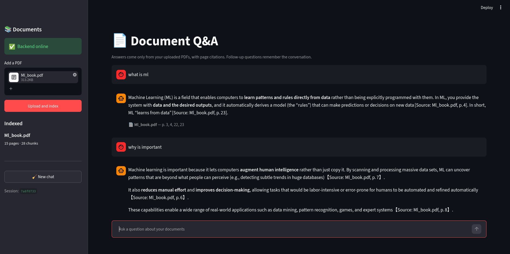

<h1 align="center">📄 Document Q&A RAG Chatbot</h1>

<p align="center">
  <b>Advanced Retrieval-Augmented Generation over your PDFs, with page citations, measured with a real evaluation.</b>
</p>

<p align="center">
  <a href="https://github.com/QosainBukhari/Document-Q-A-RAG-Chatbot/actions/workflows/ci.yml"></a>
  
  
  
  
  
  
  
  
</p>

<p align="center">
  <a href="#quick-start">Quick start</a> ·
  <a href="#architecture">Architecture</a> ·
  <a href="#config-flags">Config flags</a> ·
  <a href="#evaluation">Evaluation</a> ·
  <a href="docs/ADVANCED_RAG.md">How it works</a> ·
  <a href="docs/INTERVIEW_QA.md">Interview Q&A</a>
</p>

Upload any PDF and ask questions about it. Answers are grounded in the document,
with page citations. The project started as a naive RAG pipeline and was upgraded
to an **advanced RAG** system:

- parent-child chunking
- hybrid BM25 + dense search with Reciprocal Rank Fusion
- cross-encoder reranking
- contextual compression
- query rewriting

Every technique can be switched on or off in config, and an **evaluation** measures
whether each one actually helps. Everything runs on a CPU laptop with free tools.

<p align="center">
  
</p>

## Quick start

```bash
git clone https://github.com/QosainBukhari/Document-Q-A-RAG-Chatbot.git
cd Document-Q-A-RAG-Chatbot
make install          # venv + CPU-only torch + requirements, creates .env
# put your free Groq key in .env  →  GROQ_API_KEY=...
make api              # terminal 1: backend  → http://localhost:8000/docs
make ui               # terminal 2: chat UI  → http://localhost:8501
```

Or run `docker compose up --build`, and run `make help` to see all commands.

## Features

- Upload PDFs; re-uploading a file **replaces** it (stable chunk IDs, no duplicates)
- Answers with **source + page citations**
- **Per-session chat memory**, with follow-up questions rewritten into standalone ones
- **Advanced retrieval** (each part ON/OFF in [`configs/config.yaml`](configs/config.yaml)):
  - parent-child chunking
  - hybrid search
  - RRF fusion
  - reranking
  - compression
  - multi-query
  - HyDE
  - query decomposition
  - multi-vector summaries
- **Evaluation**: Recall@K, MRR, faithfulness, context precision and context recall,
  using hand-written metrics and LLM-as-judge prompts
- Optional **Langfuse tracing** of every step, with latency per step
- **Chat UI (Streamlit):**
  - conversation history on screen
  - sidebar for upload, backend status and the list of indexed PDFs
  - page citations under every answer, and the rewritten question for follow-ups
  - a "New chat" button that starts a fresh session
  - clear error messages, including rate limits
- FastAPI backend, Docker Compose, GitHub Actions CI (offline tests with fakes)

📘 **How every technique works, explained simply:** [docs/ADVANCED_RAG.md](docs/ADVANCED_RAG.md)
🎤 **Interview questions about this project:** [docs/INTERVIEW_QA.md](docs/INTERVIEW_QA.md)

---

## Tech Stack

| Part | Tool |
|---|---|
| API / UI | FastAPI, Streamlit |
| LLM | Groq API: any Groq model via `GROQ_MODEL` (`.env.example`: `openai/gpt-oss-20b`; code default `llama-3.1-8b-instant`) |
| Embeddings | `all-MiniLM-L6-v2` (sentence-transformers, CPU) |
| Vector DB | ChromaDB (+ JSON docstore for parent chunks) |
| Keyword search | `rank_bm25` |
| Reranker | `cross-encoder/ms-marco-MiniLM-L-6-v2` (CPU) |
| Tracing | Langfuse (optional) |
| DevOps | Docker Compose, GitHub Actions, pytest |

---

## Architecture

```text
INGESTION  (POST /upload)
PDF ─► pages (pypdf) ─► parent chunks (~1500 chars) ──────────────► JSON docstore
                             └─► child chunks (~300 chars) ─┬─► MiniLM embeddings ─► ChromaDB
                                                            └─► BM25 index (in memory, rebuilt from docstore)
       [optional] LLM summary per parent ─► extra vector pointing to the parent (multi-vector)

QUESTION  (POST /chat, per session_id)
question + chat history
  ─► query rewrite (Groq, only when there is history) ─► standalone question
  ─► [optional] multi-query / HyDE / sub-questions
  ─► dense search + BM25 search on children ─► Reciprocal Rank Fusion
  ─► map children → unique parent chunks
  ─► cross-encoder rerank (~20 candidates → top 4)
  ─► compression (keep query-relevant sentences, page metadata kept)
  ─► prompt ─► Groq LLM ─► answer + page citations
        every step = one span in a Langfuse trace (optional)
```

---

## Project Structure

```text
app/                    FastAPI: main.py, routes (upload, chat), services, schemas, startup
src/
├── components.py       builds the whole pipeline from the config (used by API, eval, tests)
├── config.py           loads config.yaml + optional override file
├── ingestion/          pdf_loader, chunker (naive + parent-child), pipeline, multi_vector
├── embeddings/         HuggingFace embedding model
├── vectordb/           chroma_store (stable IDs, replace-on-upload), docstore (JSON)
├── retriever/          retriever, bm25_index, fusion (RRF), reranker, compressor
├── llm/                groq_client, rag_chain, prompts (ALL prompts), query_transformer,
│                       conversation_memory (per session), llm_utils (retry/backoff)
└── observability/      tracing (optional Langfuse)
configs/
├── config.yaml         default pipeline + all ON/OFF flags
└── eval/               overrides for each experiment (naive, hybrid, rerank, advanced, ...)
evaluation/             eval_dataset.json, metrics.py, judges.py, run_eval.py, results/
docs/                   ADVANCED_RAG.md, INTERVIEW_QA.md
tests/                  pytest suite (fake embeddings / fake LLM, runs offline)
samples/                Ml_book.pdf (test + evaluation document)
assets/                 screenshot
streamlit_app.py, Makefile, Dockerfile, docker-compose.yml, .env.example, pytest.ini
```

---

## Setup

### 1. Clone and install

```bash
git clone https://github.com/QosainBukhari/Document-Q-A-RAG-Chatbot.git
cd Document-Q-A-RAG-Chatbot

python3.11 -m venv venv && source venv/bin/activate
pip install torch --index-url https://download.pytorch.org/whl/cpu   # CPU-only, much smaller
pip install -r requirements.txt
```

### 2. Environment variables

```bash
cp .env.example .env
```

Then open `.env` and set at least `GROQ_API_KEY` (free at <https://console.groq.com/keys>).

| Variable | Meaning | Default |
|---|---|---|
| `GROQ_API_KEY` | Groq key (needed for `/chat` and the LLM judges) | — |
| `GROQ_MODEL` | Any Groq chat model | `openai/gpt-oss-20b` in `.env.example` |
| `EMBEDDING_MODEL` | sentence-transformers model | `all-MiniLM-L6-v2` |
| `CHROMA_DB_DIR` | Where Chroma + docstore are saved (empty = in memory) | `models/chroma_db` |
| `CONFIG_PATH` | Pipeline config the API loads | `configs/config.yaml` |
| `API_URL` | Backend URL used by Streamlit | `http://localhost:8000` |
| `LANGFUSE_PUBLIC_KEY` / `LANGFUSE_SECRET_KEY` / `LANGFUSE_BASE_URL` | Optional tracing | empty = off |

### 3. Run

```bash
make api   # backend:  uvicorn app.main:app --port 8000
make ui    # frontend: streamlit run streamlit_app.py
```

Or with Docker (the vector DB is kept in a volume):

```bash
docker compose up --build
```

- Frontend: <http://localhost:8501>
- API docs: <http://localhost:8000/docs>

---

## Config flags

All in [`configs/config.yaml`](configs/config.yaml).

| Flag | Default | What it does | Extra cost |
|---|---|---|---|
| `chunking.strategy` | `parent_child` | `naive` (1000-char chunks) or search 300-char children, return 1500-char parents | more vectors |
| `retriever.top_k` / `candidates` | 4 / 20 | chunks sent to the LLM / chunks fetched before narrowing | — |
| `retriever.hybrid.enabled` | `true` | BM25 + dense, fused with RRF (`rrf_k: 60`) | ~5 ms |
| `retriever.rerank.enabled` | `true` | cross-encoder re-scores candidates | ~0.6 s CPU |
| `retriever.compression.enabled` | `true` | keep sentences with similarity ≥ `similarity_threshold` | ~0.4 s CPU |
| `query_transform.rewrite` | `true` | follow-up → standalone question (only if there is history) | 1 Groq call |
| `query_transform.multi_query` | `false` | search with `num_queries` rephrasings too | 1 Groq call |
| `query_transform.hyde` | `false` | search with a hypothetical answer | 1 Groq call |
| `query_transform.decomposition` | `false` | search with sub-questions | 1 Groq call |
| `multi_vector.enabled` | `false` | index an LLM summary per parent | 1 Groq call **per parent at upload** |

The ~0.6 s and ~0.4 s figures are CPU timings from one live trace on a laptop:

```text
query-transform 622 ms | search 29 ms | parent-mapping 1 ms | rerank 556 ms | compression 369 ms | generation 714 ms
```

To run the API with a different pipeline, set `CONFIG_PATH` in `.env`. The
`configs/eval/*.yaml` files are *overrides*, applied on top of `config.yaml` by the eval script.

---

## Evaluation

**Dataset:** [`evaluation/eval_dataset.json`](evaluation/eval_dataset.json) has 25 questions
about `samples/Ml_book.pdf`. Each question comes with a reference answer and the page(s)
that contain the answer.

**Metrics:**
- **Retrieval:** Recall@1/2/4 and MRR, computed in plain Python from page numbers.
- **Generation:** faithfulness, context precision and context recall. These use
  LLM-as-judge prompts: the LLM only gives yes/no verdicts per claim or chunk, and
  Python computes the scores.

```bash
python -m evaluation.run_eval --config naive              # one experiment
python -m evaluation.run_eval --config advanced --retrieval-only   # no Groq calls
python -m evaluation.run_eval --config rerank --limit 5   # quick test
```

The PDF is indexed into a temporary folder, so your real database is never touched.
Results go to `evaluation/results/`:
- `<config>_per_question.csv`: every question, retrieved pages, answer and scores
- `summary.csv` / `summary.md`: one row per config

Judge calls are spaced out (`--sleep`, default 2 s) and retried with exponential
backoff when Groq returns rate-limit errors.

### Results

Measured on `samples/Ml_book.pdf` (25 questions). Judge and answer model: `openai/gpt-oss-20b` on Groq.
Each row adds one technique to the row above it.

| Config | Recall@1 | Recall@2 | Recall@4 | MRR | Faithfulness | Context precision | Context recall | Retrieval latency |
|---|---|---|---|---|---|---|---|---|
| **naive** (1000-char chunks, dense only) | **0.96** | **1.00** | **1.00** | **0.980** | **0.952** | 0.330 | 0.984 | 38 ms |
| **+ hybrid** (BM25 + dense, RRF) | 0.88 | 0.92 | 1.00 | 0.923 | 0.927 | **0.370** | 0.984 | 46 ms |
| **+ rerank** (cross-encoder) | 0.80 | 0.88 | 0.96 | 0.867 | ⏳ | ⏳ | ⏳ | ~650 ms |
| **advanced** (parent-child + hybrid + rerank + compression + rewrite) | 0.80 | 0.88 | 0.96 | 0.867 | ⏳ | ⏳ | ⏳ | ~820 ms |

⏳ = the LLM-judge run for this row is still in progress. Its retrieval numbers are final:
retrieval involves no LLM, so it is deterministic, and two separate runs gave identical values.

**What the numbers say (honest reading):**
- **The test document favours naive retrieval.** It is a small lecture deck: 15 short
  text pages that almost all contain the words "machine learning". Plain dense search
  already puts the right page first 96% of the time.
- **Hybrid search lowered top-1 accuracy.** Keyword overlap is everywhere in this deck,
  so BM25's ranking is noisy, and RRF gives that noisy list equal weight with the
  dense ranking.
- **Reranking lowered it further.** The cross-encoder was trained on web search
  passages (MS MARCO). On slide fragments it sometimes preferred a general
  "What is ML" page over the specific slide.
- **Context precision is low for every config.** Most answers are on one page but we
  always send 4 chunks, so the maximum is often 0.25–0.5. Context recall is high
  (0.98), meaning the needed facts do reach the LLM.
- **Lesson:** advanced RAG techniques are built for large, varied corpora. Run
  `make eval-all` on *your* documents before deciding which flags to keep ON. That is
  why every technique is a config switch.

Full per-question results are in `evaluation/results/`. These numbers replace the
earlier unverified "85% / 90%" claim.

---

## Example (real output, test PDF)

**Q:** What is overfitting?
**A:** "Over-fitting is when a model learns the training data too well—essentially
memorizing it—so it achieves perfect or near-perfect accuracy on that data but performs
poorly on new, unseen examples…"
**Sources:** Ml_book.pdf pages 20, 19, 22, 3

**Follow-up (same session):** How is it different from underfitting?
**Rewritten to:** "How is overfitting different from underfitting?"
**Answer:** a comparison table citing pages 19 and 20.

---

## API

| Method | Path | Body | Success | Errors |
|---|---|---|---|---|
| GET | `/health` | — | `{"status": "ok"}` | — |
| POST | `/upload` | multipart `file` (PDF) | `{message, filename, pages, parent_chunks, total_chunks}` | 400 not a PDF · 422 unreadable PDF · 500 |
| POST | `/chat` | `{"question": "...", "session_id": "optional"}` | `{question, standalone_question, answer, sources, session_id}` | 422 empty question · 429 Groq rate limit · 500 |
| GET | `/documents` | — | `[{source, pages, chunks}]` indexed PDFs | — |

Send the returned `session_id` with your next question to keep your own conversation history.

---

## Observability (Langfuse, optional)

1. Create a free project at <https://cloud.langfuse.com>, or self-host it with Docker
   (see the Langfuse docs).
2. Put `LANGFUSE_PUBLIC_KEY`, `LANGFUSE_SECRET_KEY` and `LANGFUSE_BASE_URL` in `.env`,
   then restart the API.
3. Every question becomes one trace. It contains these spans, each with its latency:
   - `query-transform`
   - `search`
   - `parent-mapping`
   - `rerank` (with scores)
   - `compression`
   - `generation` (prompt and answer)

   Traces are grouped by `session_id`, and uploads appear as `ingest` traces.

Without the keys, tracing is off and the app works exactly the same. Step latencies
are still written to `logs/app.log`.

---

## Tests & CI

```bash
make test        # or: pytest -q
```

- Most tests use fake embeddings and a fake LLM, so they run offline in about 20 s.
- Tests that call Groq are skipped when `GROQ_API_KEY` is not set.
- Current result: 62 passed with a key; 60 passed and 2 skipped without one.
- GitHub Actions runs the suite on every push and pull request to `main`
  (CPU-only torch).

---

## Future work

- Evaluate on a larger, more varied document set and tune `top_k` and the thresholds on it
- Store sessions in Redis; use a database instead of the JSON docstore
- Stream answers; add authentication
- Try stronger or multilingual embedding and reranker models

---

## Author

**Syed Qosain Hyder Bukhari**

- GitHub: <https://github.com/QosainBukhari/Document-Q-A-RAG-Chatbot>
- LinkedIn: <https://www.linkedin.com/in/syedqosainbukhari>
